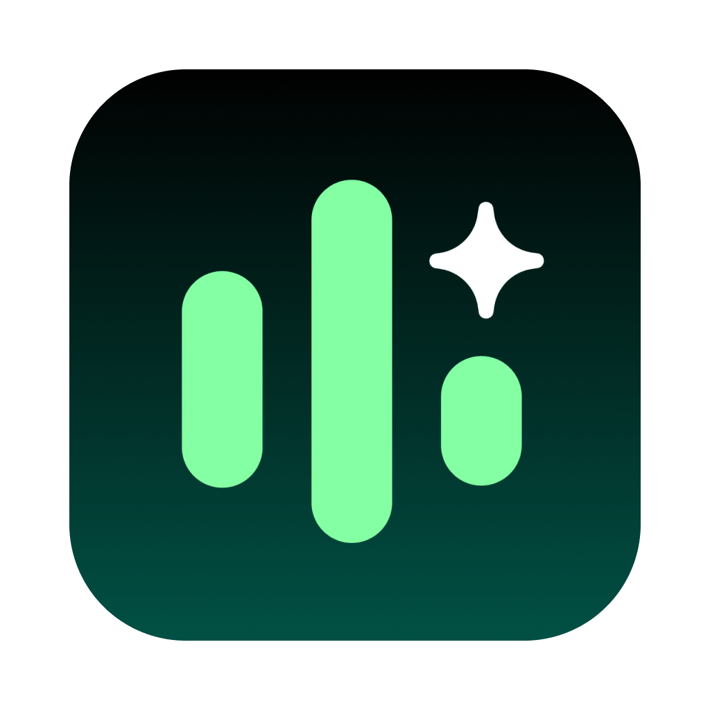

# Voiskey Plugin for Cursor

  

  <b>Find meeting notes, transcripts, and action items from Voiskey.</b>

---

## Overview

The **Voiskey** plugin connects your [Voiskey AI Notetaker](https://www.voiskey.ai) with Cursor. It allows Cursor AI Agents to directly access and synthesize your meeting context, structured notes, action items, and transcripts without manual copy-pasting.

## Key Capabilities

* **Search & Recall Meetings**: Quickly query past discussions by keyword or date range (`search_meetings`).
* **Extract Summaries & Tasks**: Retrieve structured meeting notes and pending action items (`get_meeting_summary`).
* **Inspect Full Transcripts**: Access complete, timestamped speech-to-text transcripts with speaker labels (`get_meeting_transcript`).
* **Account Context**: Identify attendee identities with user profile context (`get_account_info`).

## Example Prompts in Cursor

* *"What were the key decisions made in my architecture review meeting today?"*
* *"Find all action items assigned to me across meetings this week."*
* *"Search my Voiskey meeting notes for discussions regarding database migration."*
* *"Draft a formal follow-up email based on my last client meeting transcript."*

## Available MCP Tools

| Tool Name | Description | Key Arguments |
| :--- | :--- | :--- |
| `search_meetings` | Search past meetings and notes by title or date range | `query` (string), `limit` (number) |
| `get_meeting_summary` | Fetch AI-generated summary, key points, and action items | `meeting_id` (string, required) |
| `get_meeting_transcript` | Retrieve full timestamped transcript segments with speaker names | `meeting_id` (string, required) |
| `get_account_info` | Get current user's profile to align attendee identity | None |

## Privacy & Security

* **Scoped Access**: Voiskey MCP only provides access to recorded Notetaker meetings and notes. **It has no access to your real-time dictation or typing history.**
* **Secure OAuth 2.0**: All data access is authenticated and authorized through standard OAuth 2.0 protocols.

## Testing & Reviewer Notes

For marketplace reviewers testing this integration:
* **MCP Server Endpoint**: `https://api-sandbox.voiskey.ai/connect/mcp`
* **Protocol**: Model Context Protocol (JSON-RPC 2.0 over HTTPS)
* **Auth**: OAuth 2.0 with PKCE (S256) support. You may sign in with test credentials or request access from `contact@voiskey.ai`.

## Links

* [Voiskey Official Website](https://www.voiskey.ai)
* [Privacy Policy](https://www.voiskey.ai/privacy)
* [Terms of Service](https://www.voiskey.ai/terms)
